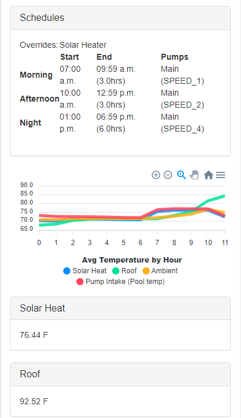
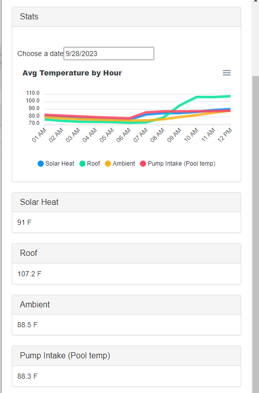
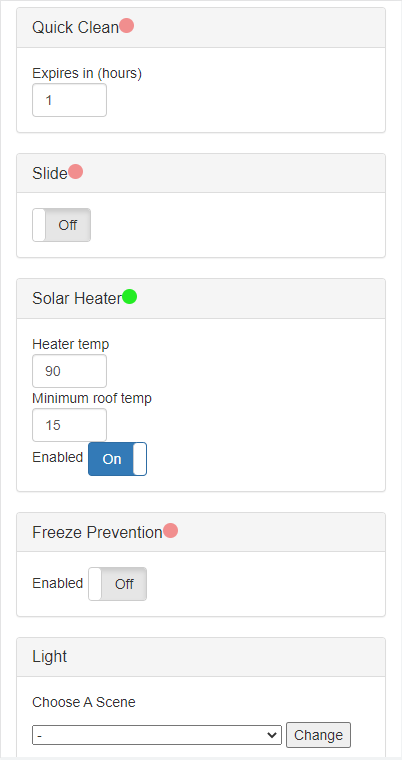
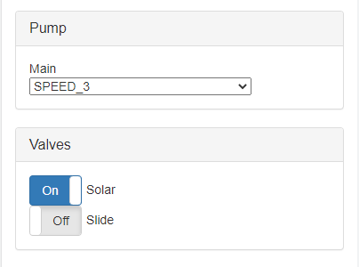
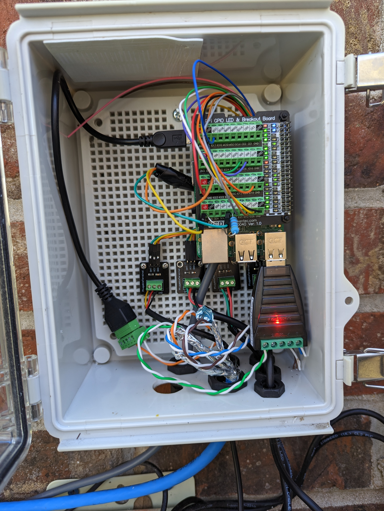
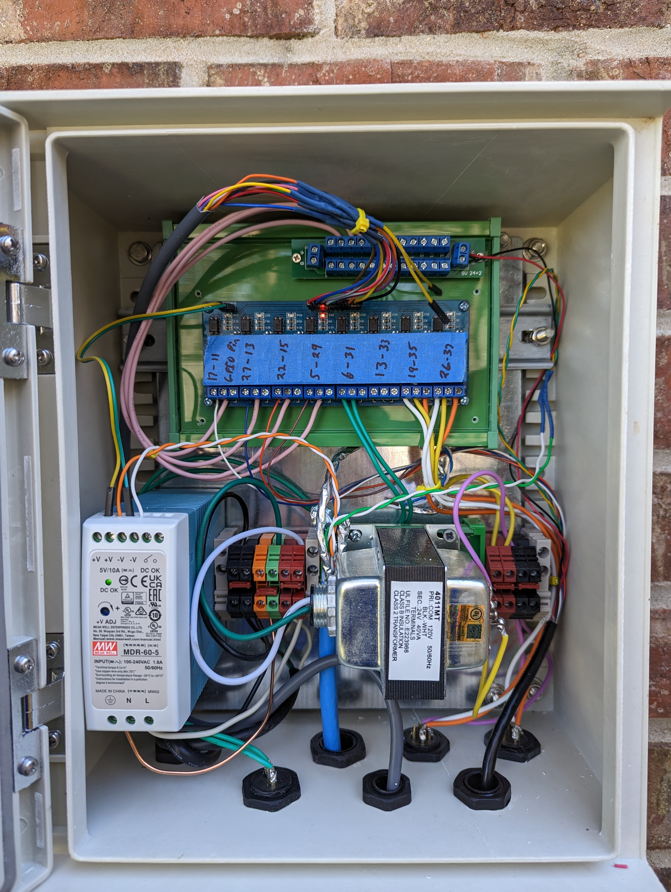

# Pool Automation
UI is mobile first and API first implementation. The backend communicates via JSON services to the UI written in Angular.

Custom schedules can be configured. You get feed back of which schedule is running and for how long. Actions can override the schedule at any time to prevent the pump or anything else from making changes.

Temperature information is updated live using server sent events from the backend. If you implement logging of the temperature you can display the information over time from all of the sensors. 

You can configure custom actions that listen for events to make decisions. Each UI component is a variable and built dynamically. Changing any value fires an event and any component can listen to the events to change the application flow. See Plugins folder for examples

If you need to override anything at any time you get access to the individual devices. This is helpful when backwashing or emptying the pump basket.

Created to run on a raspberry pi

## Local environment setup
1. Install latest version of VS Code
2. Install python version that matches the version in the Dockerfile at the top. 
    EX: FROM arm32v7/python:3.10.10-slim AS BASE 
    3.10 is the python version
3. Assuming you are on windows: In the VS Code terminal run "python -m pip install -r requirements.txt"
 If you get an error about permissions, open a terminal as admisistrator and run the install command again.
4. Add a configuration file in VS Code to execute startup.py
5. The log output should indicate where the site is hosted. It defaults to http://localhost:8080
6. Angular setup
    * Make sure node js is installed if not see: https://nodejs.org/en
    * npm install -g @angular/cli
    * cd into www
    * run "npm install"
    * To start the front end for Angular run "ng serve --open" in the terminal while in the www/ folder
### Running docker image locally
    docker run -p 8080:8080 -e 'TZ=America/Chicago' -e 'ROOT_FOLDER=/app' pool-automation:latest

All devices are stubbed out when it can't find the pi libraries.

The state logger is stubbed out the same way. Running locally without a database, it invents a few
days of readings in memory so the stats chart and the temperature and chemistry trends have
something to show. Nothing is written to disk and the history starts over on every restart. To see
what an install with no database at all looks like, where the trends drop off the panels entirely,
set the environment variable NO_STATE_LOGGER.

## Home Assistant (MQTT)
The HomeAssistant plugin pushes every change to an MQTT broker, so Home Assistant gets updates as they happen
instead of polling. It uses Home Assistant MQTT discovery, so everything shows up on its own under a single
"Pool Automation" device once the MQTT integration is set up in Home Assistant.

It is off unless MQTT_HOST is set.

| Environment variable | Default | |
|---|---|---|
| MQTT_HOST | | Broker host name. Required to turn it on. |
| MQTT_PORT | 1883 | |
| MQTT_USERNAME / MQTT_PASSWORD | | Only needed if the broker requires a login. |
| MQTT_TOPIC_PREFIX | pool-automation | Root of every state and command topic. |
| MQTT_DISCOVERY_PREFIX | homeassistant | Must match the discovery prefix in Home Assistant. |

What shows up in Home Assistant:
* Pumps - select (speed), can be changed
* Valves - switch, can be changed
* Lights - select (scene or OFF), can be changed
* Variables shown in the UI - switch (bool) or number (int/float), can be changed. Hidden variables are read only.
* Temperature sensors, pH, ORP - sensors
* Schedule overrides per action and the running schedule - read only

All state is published retained to `{prefix}/{type}/{name}/state`, commands are read from `{prefix}/{type}/{name}/set`
and `{prefix}/status` is online/offline.

    docker run ... -e 'MQTT_HOST=192.168.1.10' -e 'MQTT_USERNAME=pool' -e 'MQTT_PASSWORD=*****' ...

## Docker on pi
Install docker by following the directions here: https://www.simplilearn.com/tutorials/docker-tutorial/raspberry-pi-docker

### Automated deployment
Every push to master runs the tests, builds the 32 bit arm (arm/v7) image on GitHub (.github/workflows/publish.yml) and publishes it to
ghcr.io/coreyfournier/pool-automation, tagged latest and with the commit sha. Publishing waits for someone to approve
it in the production environment (Actions > the run > Review deployments), so nothing reaches the pi without a person
saying so.

Master can't be pushed to directly. Changes go through a pull request, which runs the tests and can only be merged once
they pass. Force pushes and deleting master are blocked. Watchtower runs on the pi, checks for a new
image every 5 minutes and restarts the container when it finds one. The pi only ever pulls, so nothing on the network
has to be opened up. Secrets live in a .env file on the pi and never go in git or the image.

One time setup on the pi:
1. Copy deploy/docker-compose.yml and deploy/.env.example to /home/pi/pool. Rename .env.example to .env and fill it in.
2. Remove the container started by the old docker run command: sudo docker container rm pool-automation -f
3. cd /home/pi/pool && sudo docker compose up -d

The image is private the first time it's published. Either make it public (GitHub > Packages > pool-automation >
Package settings > Change visibility), which is fine because the image holds no secrets, or keep it private and run
"sudo docker login ghcr.io" on the pi with a personal access token that has read:packages, then uncomment the
config.json volume on watchtower in docker-compose.yml.

To roll back, change the image tag in docker-compose.yml to an older sha tag (shown on the package page) and run
"sudo docker compose up -d". Watchtower only follows the tag that is in the file.

* Deploy now instead of waiting on watchtower: sudo docker compose pull && sudo docker compose up -d
* See what watchtower did: docker logs watchtower

### Manual deployment
Still works if GitHub isn't an option. Add your local repo as a trusted repository on both the build and destination machine: https://stackoverflow.com/questions/49674004/docker-repository-server-gave-http-response-to-https-client
#### Locally
1. docker build -f "Dockerfile" . -t "pool-automation:latest" --platform=linux/arm/v7
2. docker tag "pool-automation:latest" "192.168.1.4:5050/pool-automation:latest"
3. docker push 192.168.1.4:5050/pool-automation:latest

#### On the server
1. docker pull 192.168.1.4:5050/pool-automation:latest
2. sudo docker container rm pool-automation -f
3. With out privileged i can't get access to the temp sensors. 
sudo docker run -it -p 8080:8080 -e 'TZ=America/Chicago' -e 'ROOT_FOLDER=/app' -e 'PoolAutomationSqlConnection=*************' --device /dev/gpiomem:/dev/gpiomem -v /sys:/sys -v /dev/i2c-1:/dev/i2c-1 -v /home/pi/pool/data:/app/data --privileged --name pool-automation 192.168.1.4:5050/pool-automation:latest

##### Troubleshooting 
* Viewing logs
    docker logs pool-automation
    Set the environment variable ENV_LOG_SERVER_NAME and ENV_LOG_SERVER_PORT to send logs to a sys log server.
* Restart container
    docker restart pool-automation
* Remove old images
    docker image prune

## Authentication
No security is provided, but I used my synology nas to help me out here. I already have a certificate installed on it. The NAS also provides an option for reverse proxy, but it doesn't include authentication. I found a docker container project that provides the LDAP authentication. With the two, i piped traffice from one proxy to another. I could just use the Docker container, but then I would have to manage the cert in two places. This is a set it and forget it solution.

### Synology Reverse Proxy
I used Synology Application proxy to manage HTTPS and configured it to point to it's self 8081.
You can read about how to configure it here: https://mariushosting.com/synology-how-to-use-reverse-proxy/
1. Source
    * protocol HTTPS
    * hostname: {YouNasServerName}
    * Port: {Port you want to expose on the server}
2. Destination
    * Protocol: HTTP
    * Hostname: {YouNasServerName}
    * Port: {The port number you are going to use in the container}

### Docker Container in Synology for LDAP authentication
reverse proxy container using: https://hub.docker.com/r/dariko/httpd-rproxy-ldap/

Set the following configuration for the container:
1. Initial screen
    * Set resource limitation to 256MB
2. Go to advanced settings
    1. Enabled auto-restart
    2. Network - choose "Use the same network as Docker Host"
    3. Port Settings - Container port 8081
    4. Environment
        * LDAP_URI=ldap://{DomainName.com}/dc={DomainName},dc=com?uid?sub?(objectClass=*)
        * PROXY_URI=http://{YourPi}:8080/
        * LISTEN_PORT=8081
        * SERVERNAME={YouNasServerName}    
